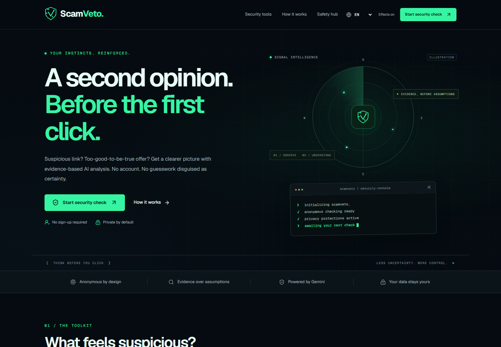

# ScamVeto

**Detect Deception. Stay Protected.** A privacy-conscious Next.js application for examining suspicious links, messages, job offers, shopping claims and screenshot text.



## Run locally

Use Node.js **24 LTS** and npm.

```powershell
npm ci
Copy-Item .env.example .env.local
# Edit .env.local with your provider configuration.
npm run dev
```

Open http://localhost:3000. `npm ci` prepares the local OCR worker and WebAssembly files. If installation scripts are disabled, run `node scripts/prepare-ocr.mjs` yourself.

AI analysis requires **both** `GEMINI_API_KEY` and `GEMINI_MODEL`. Choose a currently available structured-output model for your Google account using [Google's model documentation](https://ai.google.dev/gemini-api/docs/models). There is deliberately no hardcoded model or fake AI fallback. Without credentials, local submissions return HTTP 503 with a configuration message and any completed deterministic findings. Production analysis remains unavailable until abuse protections are configured.

## Implemented

- Responsive dark interface, original SVG identity, radar illustration, terminal, keyboard navigation, reduced motion/effects, mobile navigation and 320px layouts.
- Five anonymous checker workflows, real server API handlers, client/server validation and ephemeral report display. No public report URLs or default persistence.
- HTTP(S) parsing and normalization with `tldts` public/private suffix handling; misleading user information, deceptive brand references, encoded paths and contextual IDN/HTTP indicators. IP and local hostnames are rejected. **No submitted destination is fetched or crawled.**
- Contextual message/job/shop rules for security codes, credentials, advance fees, urgency, remote access, payment methods, prizes and return guarantees. Optional recruiter-domain comparison is contextual, never identity verification.
- Google Gemini integration using `@google/genai`, configurable server model, JSON Schema output, Zod response validation, excerpt grounding, transport timeout and two maximum attempts. Model tools are disabled.
- Genuine Google Cloud Web Risk Lookup adapter. Results distinguish match, no match and unavailable. Lookups strip query strings, fragments and credentials to reduce disclosure, which reduces lookup coverage.
- Server-owned five-category outcomes; Gemini interpretation is displayed separately and cannot override a threat-list match. No invented probability scores.
- Browser-only Tesseract OCR with preview, drag/drop, file picker, clipboard image paste, editable extracted text, byte signatures and pre-decode pixel limits. No image-upload API or direct image forwarding.
- English, Hindi and Gujarati core navigation, form labels, result labels, deterministic guidance, outcome summaries and Gemini language instructions. Editorial articles, legal pages and some secondary interface copy are currently English; they are explicitly identified as English for assistive technology. Translation architecture is extensible.
- Nine educational guides, official recovery resources, privacy/terms/about/contact pages, metadata, canonical paths, social image, sitemap and robots.
- Same-origin API enforcement, request byte limits, distributed production rate limiting, server-side Turnstile verification, security headers, inert React text rendering and content redaction. No raw-submission application logs.
- Optional Supabase client infrastructure and SQL RLS migration. No anonymous report storage.

## Configuration

| Variable | Required | Meaning |
| --- | --- | --- |
| `GEMINI_API_KEY` | AI | Server-only Google Gemini API key. |
| `GEMINI_MODEL` | AI | Account-supported model with JSON Schema output. |
| `GOOGLE_WEB_RISK_API_KEY` | Optional | Key for the enabled Web Risk Lookup API. Missing/failing lookups are unavailable, never called clean. |
| `APP_BASE_URL` | Production | Exact HTTPS origin, without trailing slash. Used for origin checks, Turnstile hostname, canonicals and sitemap. Local example is `http://localhost:3000`. |
| `NEXT_PUBLIC_TURNSTILE_SITE_KEY` | Production | Public Turnstile site key restricted to deployment hostnames. |
| `TURNSTILE_SECRET_KEY` | Production | Server-only challenge verification secret. |
| `UPSTASH_REDIS_REST_URL` | Production | HTTPS Redis REST endpoint for distributed rate limits. |
| `UPSTASH_REDIS_REST_TOKEN` | Production | Server-only token permitted to run the limiter's atomic Redis script. |
| `RATE_LIMIT_HASH_SECRET` | Production | At least 32 random bytes, used to HMAC network identifiers. |
| `ANALYSIS_RATE_LIMIT` | Optional | Default 10 attempts per 10-minute window per deployment-provided IP, shared across checker routes. Bounded to 1–100. |
| `TRUSTED_PROXY` | Production | `vercel`, with the platform-provided `VERCEL` variable. Other ingress architectures require a reviewed adapter. Local development uses a shared in-memory bucket. |
| `NEXT_PUBLIC_SUPABASE_URL` | Future accounts | Optional project URL. |
| `NEXT_PUBLIC_SUPABASE_ANON_KEY` | Future accounts | Optional public anon/publishable key. |
| `SUPABASE_SERVICE_ROLE_KEY` | Not used | Reserved for future restricted administration. Never add to the browser. Not needed for anonymous checks. |

Do not place secrets in `NEXT_PUBLIC_*` variables. `.env.local` is ignored by Git. Do not paste API keys into issue reports, screenshots or chat.

## Architecture

```text
src/app/                       App Router pages, metadata and HTTP handlers
src/components/checkers/       Forms, consent, OCR and Turnstile
src/components/cyber/          SVG/CSS visual components
src/components/reports/        Ephemeral evidence report, copy and print
src/components/ui/             Customized Radix Slot / shadcn-style primitive
src/features/analysis/         Deterministic rules, evidence and server outcomes
src/lib/gemini/                PromptBuilder, GeminiAnalysisService, validator
src/lib/threat-intelligence/   Provider interface and Web Risk adapter
src/lib/security/              Redaction, origin, limiter and challenge checks
src/lib/i18n/                  Typed English/Hindi/Gujarati dictionaries
src/lib/db/                    Optional user-token Supabase factory
supabase/migrations/           Optional RLS-protected reports table
tests/                        Unit, integration, rendering and Playwright tests
```

The shared API accepts `{content, locale, turnstileToken?, company?, jobTitle?, email?, url?}` on `POST /api/analyze/{url|message|job|shop|screenshot-text}`. URL content is at most 2,048 characters; other content at most 12,000. The entire UTF-8 JSON body is limited to 20,000 bytes, so long non-Latin submissions may reach the byte limit before the character limit. Clients receive typed `{report}` or `{error:{code,message}}`; incomplete analysis can include both with HTTP 503. GET `/api/health` returns only `{status:"ok"}`.

## Evidence semantics

| Outcome | Meaning |
| --- | --- |
| `KNOWN_MALICIOUS` | Configured reputation source returned an authoritative threat match. |
| `SUSPICIOUS_INDICATORS` | Concerning supported patterns; fraud is not established. |
| `NO_KNOWN_THREAT_FOUND` | AI and all selected supported URL reputation checks completed without a match or concerning evidence. Not proof of safety. |
| `INSUFFICIENT_EVIDENCE` | Available information cannot support a meaningful safety conclusion. |
| `ANALYSIS_UNAVAILABLE` | Essential AI analysis failed without stronger available evidence. |

Stronger completed evidence remains visible when AI fails, but the HTTP response and report explicitly disclose incomplete analysis. AI indicator excerpts must occur in the redacted input or deterministic evidence. This constraint reduces fabricated evidence; it does not make AI interpretation infallible. A single uncorroborated AI indicator does not establish suspicious status. Contextual indicators alone do not establish fraud.

## Checks

```powershell
npm run typecheck
npm run lint
npm test
npx playwright install chromium
npm run test:e2e
npm run build
npm audit
```

Browser tests use controlled synthetic analysis responses and never visit submitted suspicious sites. OCR tests run the real browser worker on a generated image, downloading public language data. No paid API calls run in the test suite. See [verification notes](docs/VERIFICATION.md) for the latest actually executed results and their limits.

## Privacy boundaries

Input is processed transiently on the server. Recognizable identifiers are masked before Gemini receives text. Redaction is best effort, not a guarantee: users should remove personal details. OCR language resources may be cached by the OCR library; screenshots and reports are not intentionally persisted. Network metadata may be visible to hosting, Google, Redis, Cloudflare and OCR download providers as applicable. Their own policies apply. Hosting logs must be configured independently to avoid request bodies and excessive metadata retention.

There are no tracking analytics, visitor profiles, public reports or third-party browsing tools. Redis receives HMAC-derived IP keys with short expirations and counters, not submission content. CSP allows Next.js inline bootstrap scripts/styles and WebAssembly for OCR; it is a baseline policy, not a claim of nonce-based strict CSP.

## Deliberately not activated

- Public deployment, paid infrastructure and billing subscriptions.
- Real provider validation without your configured credentials.
- Account UI, saved history, report deletion endpoints or subscriptions. The optional RLS schema must be tested against a real Supabase instance before enabling accounts.
- Domain purchase, operator identity, jurisdiction-specific legal terms, monitored support/security email and privacy-request channel. Supply these before launch.
- Independent employer/company verification, WHOIS/domain ages, review collection, URL crawling, automatic URL opening, Gemini browsing or direct image analysis.
- Global spend guarantees. Per-IP limits and Turnstile are implemented; configure provider billing alerts, platform request controls and a suitable operational budget before opening access.

Read [deployment instructions](docs/DEPLOYMENT.md), [security architecture](docs/SECURITY.md) and the [release checklist](docs/RELEASE_CHECKLIST.md).

The project repository is [saifmodan2006/ScamVeto](https://github.com/saifmodan2006/ScamVeto). It includes a GitHub Actions verification workflow. Provider credentials are local environment settings and are never committed to the repository.
